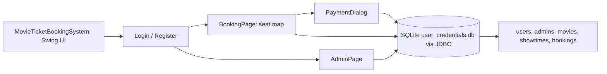

# BookMyShow Deluxe: Java Swing Movie Ticket Booking System

A desktop movie-ticket booking application written in Java Swing with an embedded SQLite database. Customers register, pick a movie and showtime, choose seats on an interactive seat map and pay through a simulated payment dialog; admins manage movies, showtimes, users and bookings.

**Links:** [GitHub](https://github.com/shriram-s7/MOVIE-TICKET-BOOKING-SYSTEM-JAVA) · [Demo video](https://youtu.be/FnWqxZYr6aU)

## Overview

The project digitises ticket management for a small theatre or institution without a web server: one Java program, one local database file. It is a course-style project with a single-window UI (`CardLayout` pages for login, booking and administration) and a separate `DatabaseManager` class that holds all SQL.

## Features

**Customers**
- Register and log in.
- Choose a movie and showtime; booked seats are shown disabled and marked `X`.
- Seat map of rows A-F with 10 seats each, colour-coded by price tier (rows A-B 120, C-D 200, E-F 300), with a running total.
- Simulated payment dialog and booking confirmation.
- View your own bookings.

**Admins**
- Add and remove movies and showtimes.
- View all bookings; delete a booking; cancel a whole show, or all bookings for a movie or showtime.
- List and delete users.
- Several **demo-only** admin accounts are created on first run by `DatabaseManager`.

## How it works



On startup `DatabaseManager.initializeDatabase()` creates the tables and the predefined admin accounts, then the UI loads movies and showtimes. Every connection runs `PRAGMA foreign_keys = ON`, which is what makes the `ON DELETE CASCADE` links from bookings to users, movies and showtimes work in SQLite.

| Table | Purpose |
|---|---|
| `users` | customer username and password |
| `admins` | admin username and password |
| `movies` | movie titles |
| `showtimes` | showtime labels |
| `bookings` | `booking_id`, user, movie, showtime, `seat_id`, `price`, booking date |

## Tech stack

| Layer | Technology |
|---|---|
| Language | Java (JDK 8 or newer; compiled here with JDK 27) |
| UI | Swing (`JFrame`, `CardLayout`, `JDialog`) |
| Database | SQLite through the `sqlite-jdbc` driver |

## Project structure

```text
MovieTicketBookingSystem.java   main(), login/register pages, BookingPage, AdminPage, PaymentDialog, BookingsDialog
DatabaseManager.java            schema creation, admin seeding and all queries
```

Both files declare `package src;`, so they are compiled into an `src` package.

## Getting started

Prerequisites: a JDK (8 or newer) and the SQLite JDBC driver jar (for example `sqlite-jdbc-3.50.3.0.jar`) downloaded from the xerial sqlite-jdbc project. The jar is not part of this repository.

**Windows (PowerShell)**

```powershell
mkdir lib, out
# put the sqlite-jdbc jar in lib\ (rename or adjust the name below)
javac -cp "lib\sqlite-jdbc.jar" -d out *.java
java -cp "out;lib\sqlite-jdbc.jar" src.MovieTicketBookingSystem
```

**Linux / macOS**

```bash
mkdir -p lib out
javac -cp lib/sqlite-jdbc.jar -d out *.java
java -cp out:lib/sqlite-jdbc.jar src.MovieTicketBookingSystem
```

The program creates `user_credentials.db` in the working directory on first launch. No environment variables are used.

## Usage

1. Launch the program; it opens on the login page.
2. Register a customer account, log in, pick a movie and showtime, select seats, then pay in the simulated dialog.
3. To use the admin panel, sign in with one of the predefined admin accounts created in `DatabaseManager.createPredefinedAdmins` (demo accounts only; see the source for the usernames); add movies and showtimes there first if the lists are empty.

## Tests

There is no test suite. Observed while writing this README: `javac -d <dir> *.java` compiled both files without errors on JDK 27. The application was not launched, since the SQLite driver jar is not in the repository.

## Status and limitations

- Semester-3 demo application. The predefined admin accounts are hard-coded **for demonstration only**; they are intentionally left as they are, so never use this app with real credentials or data.
- Working desktop prototype.
- **Passwords are stored in plain text** in SQLite, and the predefined admin accounts and their passwords are hard-coded in `DatabaseManager.java`. Do not use this for real data.
- Payment is simulated; no real payment processing.
- Seat layout and prices are fixed in code (6 rows x 10 seats).
- The database file name is not listed in `.gitignore`, so a generated `user_credentials.db` could be committed by accident.

## License

No license specified.
